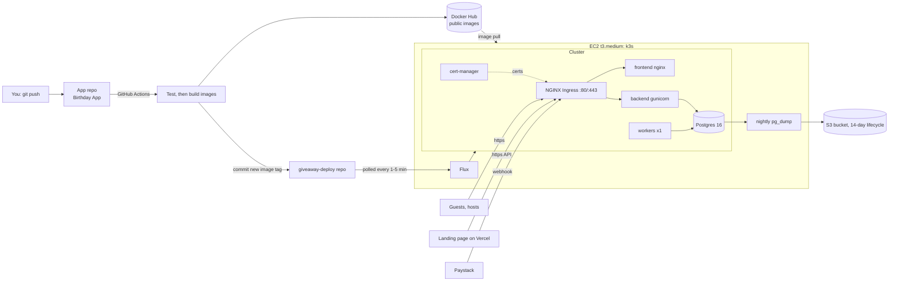

# Architecture

## In one paragraph

One EC2 server (t3.medium, Ubuntu 24.04, eu-west-1) runs **k3s**. Inside the cluster: NGINX Ingress Controller (web
entrance), cert-manager (free HTTPS certificates), Sealed Secrets (encrypted secrets in git), Flux
(applies this repo), **Postgres 16** (one database per app), the giveaway app (backend, workers,
frontend). Application code is in separate repos; their pipelines test the
code, build Docker images, push to Docker Hub, then write the new image tag into **this** repo. Flux sees
that commit and rolls the cluster forward. Postgres is backed up nightly to a private S3 bucket.

## Diagram



Same picture in plain text:

```
 developer --push--> App repo --GitHub Actions--> Docker Hub (public images)
                                   |
                                   +--commit new image tag--> giveaway-deploy repo
                                                                   ^
                                             Flux polls this repo  |
 +-----------------------------  EC2 t3.medium, k3s  ------------------------------+
 |  NGINX Ingress :80/:443 --> frontend (nginx)                                     |
 |        |         `--> backend (gunicorn) --> Postgres 16 <-- workers (1 replica) |
 |                                                     |                           |
 |  cert-manager (HTTPS)   Sealed Secrets   Flux       `--nightly pg_dump--> S3    |
 +----------------------------------------------------------------------------------+
   guests/hosts --https--> nginx        Vercel landing page --https--> backend (landing-api host)
   Paystack --webhook--> backend
```

## Components

| Piece | What it does | Where |
|---|---|---|
| k3s | Single-node Kubernetes. Built-in Traefik is disabled; ServiceLB and local-path storage are kept. Secrets encrypted at rest. | `scripts/on-server/02-install-k3s.sh` |
| Flux | Watches `main` of this repo and applies it. Four Kustomizations in order: `infrastructure` -> `infrastructure-config` -> `data` -> `apps`. | `clusters/production/` |
| NGINX Ingress Controller (F5) | Ingress controller (installed by Flux). `externalTrafficPolicy: Local` keeps real client IPs (anti-cheat depends on them). | `infrastructure/controllers/nginx-ingress.yaml` |
| cert-manager | Free Let's Encrypt certificates (HTTP-01). Staging issuer first, then production. | `infrastructure/` |
| Sealed Secrets | You encrypt on your PC with a public cert; only the cluster can decrypt. Encrypted files are safe in git. | `infrastructure/`, `scripts/` |
| Postgres 16 | StatefulSet on a local-path volume. One role + database per app. Only `giveaway` is in use; the retired `landing` database is kept for rollback. | `data/postgres.yaml` |
| Backups | CronJob 02:00 UTC: `pg_dump`, verify with `pg_restore --list`, upload to S3. | `data/backup-cronjob.yaml` |
| giveaway backend | Django + gunicorn on 8000. Migrations run in an init container before each release. | `apps/giveaway/backend.yaml` |
| giveaway workers | `run_workers`: payouts, sweeps, refunds, money checks, price sync. **Exactly one replica**, strategy Recreate. | `apps/giveaway/workers.yaml` |
| giveaway frontend | nginx on 8080, serves the React build, `/api/v1` is same-origin via the ingress controller. | `apps/giveaway/frontend.yaml` |
| landing API | The landing page's reviews/feedback API is served by the giveaway backend on the `landing-api` host (path `/api` only). The landing site stays on Vercel. | `apps/giveaway/ingress.yaml` |

## Request and deploy flows

**A guest opens the app.** Browser -> `https://app.<domain>` -> the ingress controller. `/api`, `/admin`, `/static` go to the
backend, everything else to the frontend. HTTP is redirected to HTTPS by the controller itself.

**A release.** Push to `main` in the app repo -> tests (a failing test stops the build) -> images tagged with
the 7-character commit hash -> CI commits the new tag to `apps/giveaway/kustomization.yaml` here -> Flux
applies within a few minutes -> backend init container runs `migrate`, then the new pods replace the old.

**A config change.** Edit `config.env`, push. Kustomize hashes the ConfigMap name, so the backend and workers
restart on the new values automatically.

## Decisions and the reasons

| Decision | Why |
|---|---|
| Flux GitOps instead of `kubectl` from CI | The cluster pulls; CI never holds cluster credentials. Every change is a reviewable commit and rollback is `git revert`. |
| F5 NGINX Ingress Controller (owner's choice) | Chosen by the owner over k3s's built-in Traefik. The community ingress-nginx project was retired in March 2026 (no more security fixes); the F5 controller is a separate, maintained project. Its cert-manager use needs the `http01-edit-in-place` annotation, already set. |
| One node, no HA | Fits the budget and traffic. The cost is downtime during a node reboot or failure; recovery is rebuild + restore (OPERATIONS.md). |
| Postgres in the cluster | Requested design; cheaper than RDS. Mitigated by nightly verified backups and a restore script. Move to RDS if you outgrow it. |
| Sealed Secrets | Secrets stay in git (so the repo fully describes the cluster) without exposing them. The private key backup is the one thing you must keep safe. |
| Images public, app repo private | Requested. Images contain code but no secrets: all secrets arrive at runtime. |
| No Terraform | Requested for now. The server is created by hand; `BUILD-RUNBOOK.md` records every setting so it can be redone. |
| Workers are one replica, Recreate | Two copies of the payout loop could pay a winner twice. Never scale it. |
| Money switches default off | A new live environment must not move money until the rehearsal passes. |
| `prune: false` on `data` | Deleting a file from git must never delete the database volume. |
| Landing API served by the giveaway backend, landing frontend on Vercel | The landing page's own Django service was merged into the giveaway backend (feedback is platform-level). The landing frontend still needs a full API URL: `https://landing-api.<domain>`. |

## Security notes

- Security group: only 22 (restrict to your IP if you can), 80 and 443. The Kubernetes API (6443) is not exposed.
- Postgres has no public port; it is reachable only inside the cluster.
- The EC2 IAM role may write to the backup bucket only. No AWS keys sit in the cluster.
- Kubernetes Secrets are encrypted at rest (`--secrets-encryption`).
- `HASH_PEPPER` and `PIN_ENCRYPTION_KEY` never change after launch (duplicate detection and stored PINs depend on them).
- The deploy-repo token used by CI can write to this repo; scope it to this repo only.

## Cost (rough, eu-west-1)

t3.medium about USD 35 per month, 30 GB gp3 about USD 3, Elastic IP free while attached, S3 backups cents.
Roughly USD 40 per month. Check current AWS pricing before relying on this.

## Known limits

- Single point of failure (one server). Plan a maintenance window for OS reboots.
- Only `production` exists. The layout (`clusters/<name>/`) is ready for a `staging` copy later.
- Secret rotation needs a manual restart of the pods (OPERATIONS.md).
